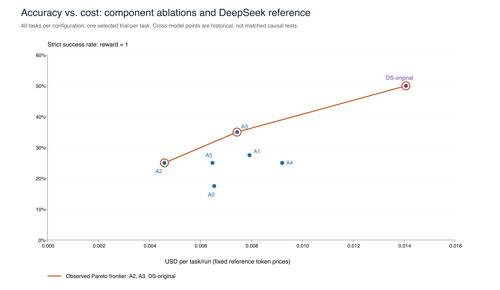
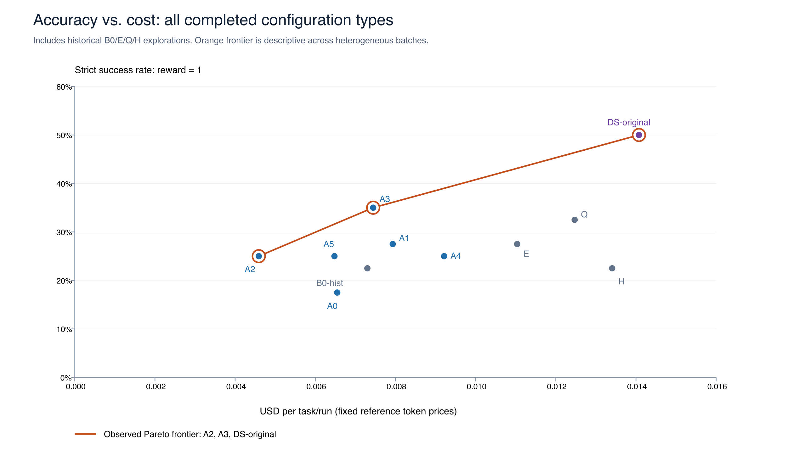

# PE6203 Experimental Report: Cost-Aware Harness Optimization

## Abstract

This project investigates whether changes to agent execution control, recovery and submission checks can improve the quality–cost trade-off on TUA-Bench while keeping the low-cost base model fixed. We extend mini-swe-agent 2.4.6 with five independently configurable components and compare A0–A5 on the same fixed 40-task subset. Historical DeepSeek results obtained with the original harness provide an additional model reference.

In the selected sample, C3 (pre-submission verification) produces the largest observed improvement: the full-pass rate increases from 17.5% for A0 to 35.0%, mean reward increases from 0.2317 to 0.4138, and estimated cost per task rises from $0.006548 to $0.007444. C2 (stall recovery) achieves a 25.0% full-pass rate at $0.004590 per task, offering a lower-cost option. The historical DeepSeek run with the original harness achieves a 50.0% full-pass rate and 0.5660 mean reward. The improved Qwen configurations do not reach that absolute success rate.

All figures come from existing experiments; preparing this report involves no new model calls. A0–A2 use second repetitions, whereas A3–A5 use a later recovery batch. DeepSeek also differs in routing, reasoning and budget settings. The results therefore describe selected single-run observations with explicit comparability limitations.

## 1. Original mini-swe-agent

mini-swe-agent implements a compact agent execution loop. In v2.4.6, the system prompt and task initialize a message history. The model requests bash tool calls, commands execute in a Linux container, and return codes and outputs become observations for the next model request. The model submits by issuing `echo COMPLETE_TASK_AND_SUBMIT_FINAL_OUTPUT` as a standalone command. An external TUA-Bench verifier scores the result.

The original implementation provides model adapters, environment execution, message history, tool-call parsing, limit checks and trajectory recording. Its default prompt primarily describes a software issue repair workflow. Each command runs in a fresh shell: filesystem changes persist, but shell state such as `cd` does not carry over automatically.

Step, cost and time limits, as well as format-error recovery, already exist upstream. Our contribution adds budget visibility, task-oriented recovery and submission checks on top of these capabilities. Default step and internal time limits may be zero, but individual experiments can configure limits. The historical DeepSeek run uses 100 steps and 2400 seconds and must not be described as unbounded.

The original harness mainly truncates tool output by length, without dedicated handling of GUI/Office noise or long observation histories. It lacks explicit stall detection and an independent artifact check before the first submission ends the run. General software repair instructions provide limited guidance for Office files, browsers and application settings. Format-error feedback is available, but repeated failures can still terminate execution.

Implementation references: [DefaultAgent execution loop](../src/minisweagent/agents/default.py) and [original prompt and configuration](../src/minisweagent/config/tua/base.yaml).

## 2. Harness improvements and rationale

`TuaAgent` extends the existing agent. C1–C4 are independent switches; C5 replaces the prompt templates. A0 disables all components and preserves the original behavior. The new checks and notices do not invoke a separate LLM service. Their feedback can nevertheless lead to additional calls to the base model, so total model-call count is not guaranteed to remain unchanged.

| Component | Implementation | Motivation | Cost or limitation |
|---|---|---|---|
| C1: budget visibility | Append remaining-budget notices to observations; issue a wrap-up reminder at 80%; use internal limits of 150 steps and 2200 seconds | Reserve time for saving and finishing rather than continuing exploration without awareness of the remaining budget | Notices consume input tokens; early wrap-up can reduce quality; the intervention includes budget-limit changes |
| C2: stall recovery | Detect a command repeated at least 3 times in the latest 6 steps, identical outputs and timeouts; use a 120-second command timeout, tolerance for 10 consecutive format errors and recovery templates | Encourage a strategy change when slow GUI/Office startup, repeated commands or format failures consume the budget | No strategy change is enforced; longer waits and greater error tolerance can increase cost |
| C3: pre-submission verification | Intercept the first submission; run read-only checks of paths, file sizes, Office ZIP structure and XLSX formula caches; return feedback and allow the second submission | File existence alone does not ensure that the verifier can read the expected values; feedback creates an opportunity to repair the artifact | Does not establish semantic correctness; activates only on submission; may cause additional model calls |
| C4: observation hygiene and compression | Remove known noise, collapse repeated lines, retain the first 80 and last 40 lines of long outputs, and keep only the first 400 characters of observations older than the latest 8 | Reduce distracting logs and repeated content in the context | Can discard useful information or reduce cache reuse; compression does not guarantee lower total cost |
| C5: task-domain prompts | Replace system/instance templates with guidance on environment inspection, backups, Office recalculation and saving, GUI state and final verification | Adapt the workflow to Office, browser and terminal tasks | Longer instructions consume context; contain no task answers and cannot replace model planning |

C3 does not read reference answers or modify task files through its check. C5 contains no task-specific solutions. See [TuaAgent](../src/minisweagent/agents/tua.py), [component helpers](../src/minisweagent/agents/utils/tua_utils.py) and [C5 templates](../src/minisweagent/config/tua/prompt_tua.yaml).

## 3. Experimental setup and sample selection

### 3.1 Tasks and configurations

The fixed subset in `subset-previous40.json` contains 40 manually selected tasks: 8 software/system tasks, 12 spreadsheet tasks, 12 document/email tasks and 8 cross-tool tasks. It is a subset of the official benchmark. This report selects one result per task per configuration. Full-pass rate is the number of tasks with reward equal to 1 divided by 40; mean reward is reported separately. Missing scores and tasks that did not execute count as zero in the primary fixed-denominator analysis, with exception markers retained.

A0–A5 use OpenRouter Qwen3.7 Flash, pin the provider to Alibaba, disable reasoning and disallow fallback. Other generation settings remain consistent. The associated limits and recovery parameters in A1/C1 and A2/C2 are part of those interventions. A0–A2 use the second of the original three repetitions. A3–A5 use the final completed recovery batch, including successfully resumed trials. Each configuration contributes 40 records, for 240 ablation records in total.

### 3.2 Why the second repetition was selected

For each task, A0–A2 trials are ordered by start time and the second record is selected consistently across the three configurations. Zero scores are retained; the highest score is not selected per task. Across the three configurations, the first repetition has 16 infrastructure exceptions, the second has 3 and the third has 43. The second repetition is therefore less affected by balance, connection and scoring-network problems. It still includes 2 scoring-comparison exceptions, which are not replaced with other repetitions.

This selection was made after the experiments and introduces selection bias. Its rationale is better execution completeness, not demonstrated proximity to the average across repetitions.

### 3.3 Identity and limitations of the historical DeepSeek reference

The historical DeepSeek run requests the official API alias `deepseek-flash`, enables `thinking` and `reasoning_effort=high`, allows at most 16,384 output tokens, and uses 100-step/2400-second limits. The logs do not independently identify a particular 4.1 weight version. We therefore refer to it as the historical DeepSeek Flash reference.

DeepSeek uses the direct official API and an earlier installation environment. The Qwen ablations use OpenRouter, reasoning disabled and the repaired offline installer. DeepSeek task 053 fails during installation before model execution; 010 and 025 encounter scoring-reference download problems; 079 has an input-asset problem. These records remain in the 40-task denominator. The cross-model difference includes model, reasoning, budget, routing, batch and environment effects.

The archived `DS-original` results must not be relabeled as completed runs of the planned OpenRouter `B1-dsflash.yaml` configuration. A matched comparison remains to be run.

### 3.4 Standardized cost accounting

All charts use the project's fixed price snapshot dated 2026-10-30 rather than mixing provider invoices or older LiteLLM estimates. Qwen rates per million tokens are $0.03 for non-cached input, $0.006 for cached input and $0.13 for output. The DeepSeek reference uses the project's fixed tier of $0.15/$0.003/$0.60. Because the historical request uses an official alias, this tier is a normalization assumption, not a verified historical official price.

A run means one trial on one task. The chart's horizontal axis is total cost divided by 40. Cached tokens are a subset of input tokens and must not be added to total input again. Infrastructure costs, machine costs and failed requests that return no usage are excluded from token-based cost.

## 4. Accuracy–cost analysis and the Pareto frontier

### 4.1 Main analysis: six ablations and the DeepSeek reference



*The vertical axis is strict full-pass rate, not mean reward. The orange line connects observed non-dominated configurations: no other configuration has both equal or lower cost and equal or higher success, with at least one strict improvement. Lines indicate frontier membership and do not imply interpolation between configurations.*

| Configuration | Model and components | Full passes/40 | Full-pass rate | Mean reward | USD/task | USD/40 tasks |
|---|---|---:|---:|---:|---:|---:|
| A0 | Qwen; original behavior | 7 | 17.5% | 0.2317 | 0.006548 | 0.261904 |
| A1 | Qwen; only  C1 | 11 | 27.5% | 0.3384 | 0.007931 | 0.317247 |
| A2 | Qwen; only  C2 | 10 | 25.0% | 0.2957 | 0.004590 | 0.183618 |
| A3 | Qwen; only  C3 | 14 | 35.0% | 0.4138 | 0.007444 | 0.297762 |
| A4 | Qwen; only  C4 | 10 | 25.0% | 0.2839 | 0.009214 | 0.368561 |
| A5 | Qwen; only  C5 | 10 | 25.0% | 0.2959 | 0.006478 | 0.259118 |
| DS-original | DeepSeek; historical original harness | 20 | 50.0% | 0.5660 | 0.014074 | 0.562964 |

**Observed main frontier: A2 → A3 → DS-original.** C2 offers a lower-cost option, C3 achieves a higher Qwen success rate, and the historical DeepSeek reference has the highest absolute success rate. This cross-model frontier describes historical observations; it does not demonstrate that changing the harness is equivalent to changing the model.

### 4.2 Exploratory analysis of all completed configurations

To cover the configurations actually evaluated, the exploratory chart also includes the historical original Qwen run (B0-hist), E, Q and H. H combines 21 original trials with 19 trials rerun after installation repair. Original installation failures and their replacements are not counted twice. Each configuration contributes one explicitly defined 40-task result set; smoke tests, cancelled attempts and other repetitions are not plotted as additional configurations.



| Configuration | Model and components | Full passes/40 | Full-pass rate | Mean reward | USD/task | USD/40 tasks |
|---|---|---:|---:|---:|---:|---:|
| B0-hist | Qwen; historical original harness | 9 | 22.5% | 0.2411 | 0.007299 | 0.291972 |
| E | Qwen; C1+C2+C4 | 11 | 27.5% | 0.3318 | 0.011036 | 0.441434 |
| Q | Qwen; C1+C2+C3+C5 | 13 | 32.5% | 0.3688 | 0.012469 | 0.498779 |
| H | Qwen; C1–C5 | 9 | 22.5% | 0.2910 | 0.013405 | 0.536209 |

B0-hist enables high reasoning and uses 100-step/2400-second limits. E/Q/H come from earlier exploratory batches. These records provide context and do not replace A0 as the ablation control. The exploratory frontier is also **A2 → A3 → DS-original**. Budget, caching and execution differences prevent interpreting combination rankings as causal component contributions.

## 5. Component ablation against the same control

Each comparison uses A0 versus a configuration enabling only one component, with the others disabled. The following results retain all 40 tasks.

| Configuration | Single enabled component | Mean reward | Δ mean reward | Full-pass rate | Δ percentage points | Passes gained/lost | USD/task | Δ USD/task |
|---|---|---:|---:|---:|---:|---:|---:|---:|
| A0 | None | 0.2317 | +0.0000 | 17.5% | +0.0 | 0/0 | 0.006548 | +0.000000 |
| A1 | C1 | 0.3384 | +0.1067 | 27.5% | +10.0 | 5/1 | 0.007931 | +0.001384 |
| A2 | C2 | 0.2957 | +0.0640 | 25.0% | +7.5 | 4/1 | 0.004590 | -0.001957 |
| A3 | C3 | 0.4138 | +0.1821 | 35.0% | +17.5 | 7/0 | 0.007444 | +0.000896 |
| A4 | C4 | 0.2839 | +0.0522 | 25.0% | +7.5 | 4/1 | 0.009214 | +0.002666 |
| A5 | C5 | 0.2959 | +0.0642 | 25.0% | +7.5 | 5/2 | 0.006478 | -0.000070 |

C3 has the largest observed gain, adding 7 passes without losing any task passed by A0. C1 adds a net 4 passes. C2/C4/C5 each add a net 3, but their costs differ: C2 reduces estimated cost, C4 increases it, and C5 remains close to the control. Mean reward or call count alone is insufficient to characterize a component's effect.

A4 uses 26.34M input tokens versus A0's 26.88M, but cached input falls from 24.48M to 19.55M, model calls increase from 1096 to 1282, and output tokens also increase. Local compression savings can therefore be offset by cache loss and additional execution. These aggregate figures alone do not establish that a specific task failed because of forgotten information.

### 5.1 Sensitivity to scoring exceptions

Scoring-network or comparison exceptions affect tasks 010, 016, 020, 025, 080, 083 and 096. Excluding these 7 tasks consistently leaves a common 33-task subset for every ablation configuration. Task timeouts and agent execution failures remain included.

| Configuration | Mean reward, common 33 tasks | Full passes/33 | Full-pass rate |
|---|---:|---:|---:|
| A0 | 0.2809 | 7 | 21.2% |
| A1 | 0.4102 | 11 | 33.3% |
| A2 | 0.3281 | 9 | 27.3% |
| A3 | 0.4713 | 13 | 39.4% |
| A4 | 0.3138 | 9 | 27.3% |
| A5 | 0.3284 | 9 | 27.3% |

C3 still has the highest mean reward and full-pass rate on this subset. The exclusions were determined retrospectively from observed exceptions and introduce selection bias. This analysis supplements the full 40-task results and does not remove batch differences or randomness.

## 6. Cost breakdown: inference and additional harness overhead

### 6.1 Directly observed tokens and estimated cost

| Configuration | Input tokens/task (including cached) | Cached input/task | Output tokens/task | Calls/task | Total USD/task |
|---|---:|---:|---:|---:|---:|
| A0 | 672,012.3 | 611,977.6 | 8,267.0 | 27.40 | 0.006548 |
| A1 | 736,106.8 | 655,811.2 | 12,211.0 | 29.93 | 0.007931 |
| A2 | 411,190.0 | 360,400.0 | 6,956.5 | 26.45 | 0.004590 |
| A3 | 632,601.3 | 545,171.2 | 11,924.0 | 30.38 | 0.007444 |
| A4 | 658,510.6 | 488,835.2 | 9,159.7 | 32.05 | 0.009214 |
| A5 | 624,422.8 | 556,054.4 | 8,389.0 | 25.35 | 0.006478 |
| DS-original | 657,141.8 | 631,913.5 | 13,990.2 | 20.90 | 0.014074 |
| B0-hist | 735,922.4 | 672,243.2 | 10,426.7 | 26.55 | 0.007299 |
| E | 648,964.2 | 416,995.2 | 12,113.9 | 32.15 | 0.011036 |
| Q | 1,302,053.1 | 1,173,654.4 | 12,119.8 | 44.83 | 0.012469 |
| H | 849,403.8 | 563,270.4 | 11,089.3 | 42.73 | 0.013405 |

Total cost is recomputed from the usage returned by individual responses:

```text
C_total = [(T_input − T_cached) × p_input + T_cached × p_cache + T_output × p_output] / 10^6
```

The fixed-tier recomputation of the 40-task DeepSeek cost differs from the older Harbor estimate of $0.652062. Charts use the recomputed figure. The older estimate is retained only as a historical reference and is not mixed with Qwen's fixed-price recomputation.

### 6.2 Definition of the approximate overhead allocation

The API supplies total input, cached input and output usage, without billing individual text fragments. We define **additional harness input text relative to A0** as overhead: budget and stall notices, verification feedback, recovery messages, compression markers and any positive increase in the initial C5 templates relative to A0. Additional overhead is zero for A0 and the historical original-harness groups. This does not imply that their system prompts or tool wrappers are free; original template costs belong to the inference-side residual.

For each request, we reconstruct the history and, when C4 is enabled, the compressed view used by the implementation. Before each usage-bearing call, we count the additional harness characters that would still be sent, rather than counting only their first insertion. Tokens are approximated at 4 characters per token, and the request's observed cache fraction allocates cached and non-cached input cost. When a recovery message itself carries usage from a failed response, its text is counted only in subsequent requests.

```text
T_harness,j ≈ min(T_input,j, additional_harness_characters_j / 4)
r_j = T_cached,j / T_input,j
C_harness,j ≈ T_harness,j × [(1−r_j)p_input + r_j p_cache] / 10^6
T_inference,residual = T_input + T_output − ΣT_harness,j
C_inference,residual = C_total − ΣC_harness,j
```

The inference-side residual includes generated output, task/tool information and original harness text. It is not a counterfactual estimate of inference without the component. Additional base-model generation after verification feedback remains on the inference side; the added harness does not initiate a separate dedicated LLM call. A C5 template shorter than A0 does not produce negative overhead.

| Configuration | Residual inference tokens/task ≈ | Additional harness tokens/task ≈ | Residual inference USD/task ≈ | Additional harness USD/task ≈ | Total USD/task |
|---|---:|---:|---:|---:|---:|
| A0 | 680,279.2 | 0.0 | 0.0065476 | 0.0000000 | 0.0065476 |
| A1 | 729,612.9 | 18,705.0 | 0.0077720 | 0.0001591 | 0.0079312 |
| A2 | 416,254.8 | 1,891.7 | 0.0045596 | 0.0000308 | 0.0045904 |
| A3 | 642,846.1 | 1,679.2 | 0.0074250 | 0.0000191 | 0.0074441 |
| A4 | 656,190.5 | 11,479.8 | 0.0090732 | 0.0001408 | 0.0092140 |
| A5 | 627,933.7 | 4,878.1 | 0.0064237 | 0.0000543 | 0.0064779 |
| DS-original | 671,132.0 | 0.0 | 0.0140741 | 0.0000000 | 0.0140741 |
| B0-hist | 746,349.1 | 0.0 | 0.0072993 | 0.0000000 | 0.0072993 |
| E | 633,699.3 | 27,378.8 | 0.0106326 | 0.0004032 | 0.0110358 |
| Q | 1,251,564.5 | 62,608.4 | 0.0119272 | 0.0005423 | 0.0124695 |
| H | 799,358.4 | 61,134.6 | 0.0125314 | 0.0008738 | 0.0134052 |

**This allocation is an estimate, not precise measurement.** Four characters per token is not the Qwen or DeepSeek tokenizer. Actual cache hits follow prefixes and may not be distributed evenly across added text. Serialization can introduce further tokens. Total cost derived from API usage is therefore better supported than the internal allocation. For the six main ablations, the following sensitivity scenarios combine 3–5 characters per token with assumptions that all added text is cached or none is cached:

| Configuration | Additional harness USD/task: low–high scenario |
|---|---:|
| A0 | 0.0000000 — 0.0000000 |
| A1 | 0.0000898 — 0.0007482 |
| A2 | 0.0000091 — 0.0000757 |
| A3 | 0.0000081 — 0.0000672 |
| A4 | 0.0000551 — 0.0004592 |
| A5 | 0.0000234 — 0.0001951 |

These ranges are neither statistical confidence intervals nor strict error bounds. They show sensitivity to the allocation assumptions. CPU time for local checks, compression and Docker is excluded from token-based dollars. Hook execution time was not separately logged, so no infrastructure-cost figures are inferred from it.

## 7. Failure classification and trajectory evidence

Classification follows observable failure mechanisms. A task may involve model decisions, harness behavior and scoring-environment problems together. The following verified cases do not constitute an exhaustive classification of every zero score or support fabricated category percentages.

### 7.1 Harness-level: format-error recovery exhausted

**A2 / 092-fix-tetris-bug: reward=0, exit status `RepeatedFormatError`.** The final trajectory repeatedly shows recovery messages stating that no valid bash call was received, followed by termination at the error-tolerance limit. At the model/tool interface, the model does not produce a parseable call and the harness's bounded recovery cannot resume useful execution. This is distinct from whether the model can solve the underlying code repair task. Greater error tolerance does not guarantee recovery.

Observed sequence: response without a valid tool call → feedback requiring bash → repeated invalid calls → `RepeatedFormatError` exit → zero reward.

See the [A2/092 trajectory](../results/raw/A2/092-fix-tetris-bug__ANjgV33/agent/mini-swe-agent.trajectory.json). Further investigation should examine finish reasons, output truncation, template compatibility and recovery branches. The current evidence does not establish that truncation causes all such failures.

### 7.2 Harness-level: insufficient checks before artifact submission

**A0 / 018-calculate-total-earnings: reward=0; A3 on the same task: reward=1.** A3's verification feedback identifies 2 formula cells without cached values, which a verifier using `data_only` would read as empty. The model then recalculates and saves through LibreOffice, verifies E3=191.666666666667, and passes after the second submission. This directly supports the mechanism of feedback enabling a repair. A0 provides no equivalent verification opportunity. The two trials are not controlled replays of an identical trajectory, so the entire score difference cannot be uniquely attributed to one feedback message.

See the [A0/018 control trajectory](../results/raw/A0/018-calculate-total-earnings__czbhyNY/agent/mini-swe-agent.trajectory.json) and [A3/018 verification, repair and submission trajectory](../results/raw/A3/018-calculate-total-earnings__dDcM7MF/agent/mini-swe-agent.trajectory.json).

### 7.3 Model-level: incomplete domain-specific artifact validation

**Historical original DeepSeek / 118-set-times-new-roman: reward=0.** The model edits DOCX fonts and checks package integrity, old font names and whether the file can be opened before submitting. The saved artifact still contains 2 empty runs without an explicit Times New Roman font assignment. The verifier checks fonts run by run and rejects the result. The chosen validation strategy misses objects inspected by the verifier, indicating a limitation in Office artifact manipulation or validation; insufficient harness validation may also contribute.

Observed sequence: edit fonts → scan the package for old font names and reopen/export → submit → fail strict run-level inspection. Visual correctness alone does not establish structural compliance.

See the [DeepSeek/118 trajectory](../results/raw/DS-original/118-set-times-new-roman__nHKdrme/agent/mini-swe-agent.trajectory.json) and [verifier output](../results/raw/DS-original/118-set-times-new-roman__nHKdrme/verifier/test-stdout.txt).

### 7.4 Model-level: risky process-management strategy

**A3 / 058-autosave-3-minutes: reward=0, abnormal agent exit, verification gate never reached.** The trajectory repeatedly inspects or terminates LibreOffice processes and ends after broad process-matching commands such as `pkill -9 -f libreoffice`. The evidence supports inefficient process handling followed by abnormal termination. Temporal order alone does not establish that this command directly killed the agent. C3 activates only at submission and cannot rescue a run that never reaches that stage.

See the [A3/058 trajectory](../results/raw/A3/058-autosave-3-minutes__siXzzng/agent/mini-swe-agent.trajectory.json).

### 7.5 Environment and scoring failures

DeepSeek/053 fails while installing LiteLLM, before model execution. DeepSeek/010 and 025, together with several ablation trials, encounter curl failures when downloading scoring references. The supposed MP3 input for DeepSeek/079 is actually a Google Drive warning HTML page. These cases are not direct evidence of insufficient model ability or a failed harness algorithm. Original scores are retained, and scoring exceptions are considered separately in the sensitivity analysis.

The [evidence index](../results/trials.csv) identifies each selected DeepSeek trial. After extraction, inspect the corresponding [DeepSeek evidence directory](../results/raw/DS-original/) for setup, exception and verifier logs.

## 8. Discussion

### 8.1 Which components contribute most?

Relative to the same A0 control, C3 provides the largest observed quality gain: +17.5 percentage points in full-pass rate and +0.1821 mean reward. Task 018 supplies mechanism-level support: the check identifies a repairable issue, and the model repairs it and passes. C1 improves full-pass rate by 10 percentage points while increasing cost and calls; its effect includes budget-policy changes. C2 adds a net 3 passes at lower cost, making it relevant to cost-constrained settings. C5 adds a net 3 passes with almost unchanged cost. C4 improves scores but costs more than A0, so this implementation does not achieve an overall cost reduction.

These individual effects cannot simply be added. C3 requires the model to attempt submission, C4 changes available historical information, and C1/C2 alter termination and recovery paths. Historical H passes 9/40, below C3 alone at 14/40, but differences in batch, installation and randomness prevent concluding that the components interact negatively. Matched combination runs or leave-one-component-out comparisons of the full system are needed.

### 8.2 Can a cheaper model approach the higher-scoring model reference?

A0 achieves 17.5%, A3 achieves 35.0%, and the historical DeepSeek reference achieves 50.0%. In this selected sample, C3 narrows the observed Qwen–DeepSeek gap from 32.5 to 15.0 percentage points without reaching the reference's absolute success rate. Under standardized fixed prices, A3 is cheaper than the DeepSeek reference. Model tier, token use, caching, reasoning and routing all influence this comparison, so it is not a pure harness effect.

### 8.3 Do harness gains shrink with a stronger base model?

**The existing experiments cannot answer this question.** We have original and improved Qwen configurations and an original-harness DeepSeek reference, but no C1–C5 or H results under the same DeepSeek settings. Answering the question requires measuring gains within each model and then comparing those gains.

| Comparison | Available evidence |
|---|---|
| ΔQwen(C3) = Qwen+C3 − original Qwen | +17.5 percentage points in the selected sample |
| ΔDeepSeek(C3) = DeepSeek+C3 − original DeepSeek | Not run; unknown |
| Difference in gains: ΔDeepSeek − ΔQwen | Cannot be estimated |

A stronger model might need fewer budget or recovery notices, while delivery problems involving Office caches, file saving and strict formatting could remain. DeepSeek/118 shows that domain-specific validation problems can persist. It does not prove that C3 would repair that case: the current check inspects files and structure broadly and does not check every font run.

The most useful extension is to pin model versions or document aliases, align routing/reasoning/budget/environment, and evaluate both original and improved harnesses on both models, prioritizing C3 and H. Repeated paired trials and predeclared exception handling are needed. No scores for these unperformed experiments are supplied here.

### 8.4 Limitations

The study uses only 40 tasks and reports one selected result per task per configuration. A0–A2's second repetitions were chosen retrospectively, and A3–A5 come from later recovery runs. Reference-download failures, input-asset problems and installation exceptions remain. Model aliases and provider services may change; cache state is not fully controlled; additional harness-token allocation is approximate. The findings motivate further evaluation of C3 and C2 but do not establish stability, statistical significance, full-benchmark performance or model capability limits.

## 9. Data and reproduction materials

The repository includes the [440-trial index](../results/trials.csv), [raw log archive](../results/raw-440.tar.gz), [per-file SHA-256 manifest](../results/evidence-manifest.json) and [offline recomputation script](../reproduction/recompute.py). From the repository root:

```bash
tar -xzf results/raw-440.tar.gz
python3 reproduction/recompute.py
```

After extraction, the trajectory links above work locally. GitHub does not expand the archive into browsable files.

See the [reproduction guide](../reproduction/README.md) for commands, configurations and comparison limitations. The index's `source` column retains the historical selection rationale, and file paths are repository-relative. All `result.json` files retain their original bytes and original index hashes. The archive includes scores, agent trajectories, tool outputs, exceptions and verifier logs; original task input/output artifacts are excluded. Credential redactions and their scope are documented in the reproduction guide.
